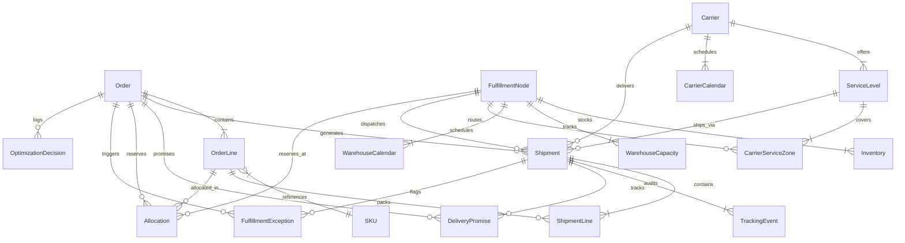

# DATABASE SCHEMA DESIGN
## Smart Order Fulfillment and Delivery Promise Optimization System

### Architecture Overview
The system employs an enterprise 3NF normalized relational schema engineered for high throughput, atomic transactions, immutable event auditing, and multi-echelon supply chain visibility.

---

### Integrity Constraints and Indexing Strategy
1. **Primary Keys:**
   - Every entity enforces a strictly typed, deterministic string primary key with prefix conventions (`ORD-`, `FUL-`, `SKU-`, `CAR-`, `SRV-`, `SHP-`, `TRK-`, `ALC-`, `EXC-`, `DEC-`).
2. **Foreign Keys:**
   - Referential integrity enforced across all relationships.
   - Deletion of parent orders cascades to order lines and allocations.
3. **Composite Unique Constraints:**
   - `inventories`: `(node_id, sku_id)` ensures exactly one inventory tracking row per product per facility.
   - `warehouse_capacities`: `(node_id, date)` guarantees unique capacity budgeting per calendar day.
   - `carrier_service_zones`: `(service_id, origin_node_id, destination_zone)` enforces single routing policy per origin-destination pair.
4. **Indexes:**
   - B-Tree indexes on all foreign keys, status enumerations, placed_at timestamps, destination zones, and tracking numbers to enable sub-5ms query response times even at 50,000+ orders scale.
